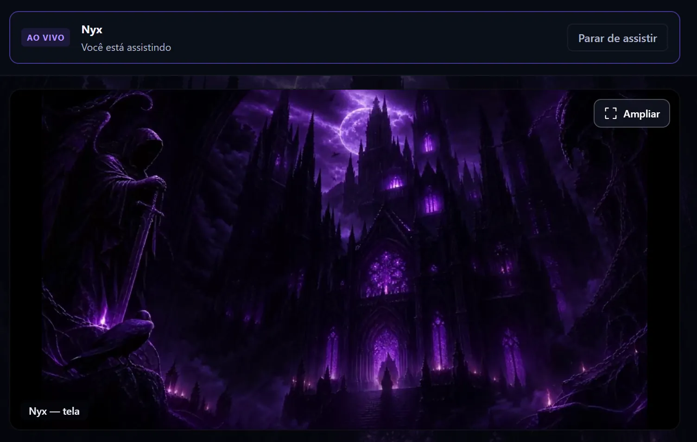

<div align="center">


<a href="https://fencenetwork.tech">
  
</a>

<br/>

<a href="https://fencenetwork.tech"></a>
<a href="https://www.linkedin.com/in/marcos-martins-3bb956350/"></a>
<a href="mailto:contato@fencenetwork.tech"></a>

</div>

<br/>

## 🦇 Sobre mim

```js
const marcos = {
  local:      "Brasil 🇧🇷",
  papel:      "Cybersecurity Engineer que coloca produto no ar",
  construindo: "Fence — voz, chat e tela para quem joga",
  stack:      ["JavaScript", "TypeScript", "Rust", "C++", "React", "Node"],
  foco:       ["tempo real", "áudio", "segurança", "desktop nativo"],
  lema:       "medir antes de afirmar",
};
```

<br/>

## 🏰 Fence — o projeto principal

<p align="center">
  <a href="https://fencenetwork.tech">
    
  </a>
</p>

**Fence** é um app de voz, chat e compartilhamento de tela feito para gamers — uma alternativa brasileira ao Discord, com servidor próprio em São Paulo. Projetei, programei, publiquei e opero tudo sozinho: desktop, servidor, mobile, infra e site.

<table>
<tr>
<td width="50%" valign="top">

**🎙️ Voz e tela em tempo real**
- SFU **LiveKit** self-hosted, porta UDP única
- Tela até **1080p / 120 FPS**, quem assiste escolhe receber
- Cadeia de voz própria: noise gate + supressão de ruído neural (GTCRN/RNNoise em **WASM**) + AEC
- Áudio do jogo capturado por **WASAPI process loopback** num addon **C++ N-API** — o som da tela sai sem devolver a voz da call

</td>
<td width="50%" valign="top">

**🛡️ Segurança de verdade**
- Senhas com **argon2**, sessões **JWT/JOSE**
- **2FA TOTP** obrigatório para administradores
- Login por Google, Steam ou senha, e-mail confirmado
- DMs acessíveis só à dupla — cargo de admin não lê conversa de ninguém
- Denúncias, verificação de idade e trilha de aceite

</td>
</tr>
<tr>
<td width="50%" valign="top">

**🎮 Feito para quem joga**
- Overlay in-game em **Rust** (5 crates: core, host, IPC, DLL, injector)
- Elo, partidas e selos de **Riot, Steam, FACEIT, Gamers Club, Leetify**
- Clipes via **Allstar** (webhook → DM), Spotify e YouTube integrados
- Mascote que fala na call com voz **ElevenLabs**

</td>
<td width="50%" valign="top">

**✨ Visual que ninguém tem**
- Temas animados com shaders **WebGL / three.js**, teto de FPS e pausa ao transmitir
- Motor de **Profile FX**: partículas, física (**planck**) e efeitos no cartão de perfil
- App **Android** em Expo + React Native com paridade visual
- Auto-update próprio e release a cada poucos dias

</td>
</tr>
</table>

<p align="center">
  
</p>

### 📊 Em números

<div align="center">

| ⏱️ Tempo | 🧾 Código | 🔁 Commits | 🚀 Versão |
|:---:|:---:|:---:|:---:|
| **6 semanas** de set/2026 até hoje | **~100 mil** linhas | **350+** | **0.3.123** no ar |

</div>

> O código do Fence é privado. Baixe o app em **[fencenetwork.tech](https://fencenetwork.tech)**.

<br/>

## 🧰 Stack

<p align="center">
  <br/>
  
</p>

<div align="center">

`WebRTC` · `LiveKit` · `WASAPI` · `N-API` · `WebAssembly` · `WebGL` · `Expo` · `React Native` · `Caddy` · `argon2` · `TOTP` · `JWT`

</div>

<br/>

## 📈 GitHub

<div align="center">
  
  
  <br/>
  
</div>


