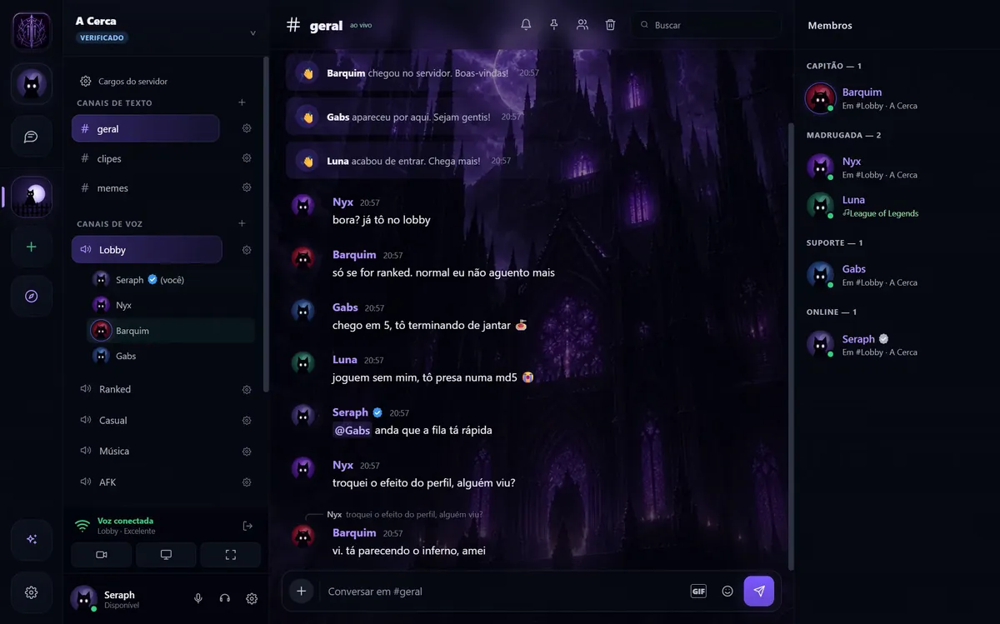
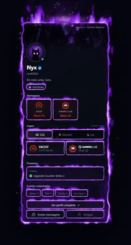
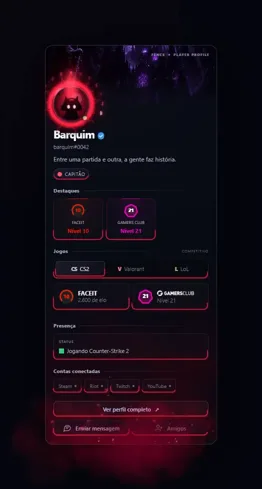
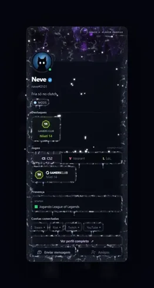
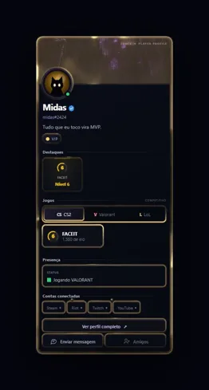
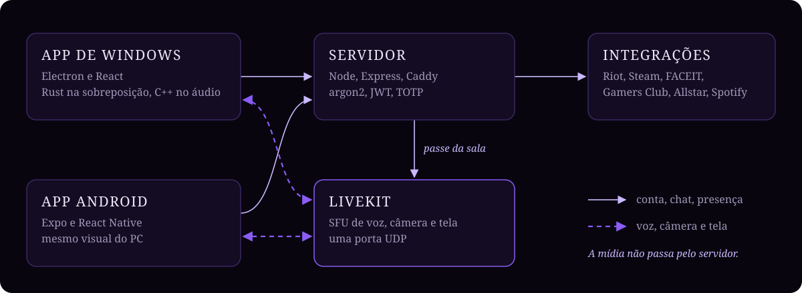

  
  
  
  

 

Engenheiro de cibersegurança que gosta de colocar coisa no ar. Nas últimas seis semanas construí sozinho o **[Fence](https://fencenetwork.tech)**: voz, chat e tela para quem joga, com servidor próprio em São Paulo. Do primeiro commit ao app publicado, passando pelo servidor, o app Android, a infraestrutura e o site.

 

## 🏰 Fence

<table>
<tr>
<td width="50%" valign="top">

### 🎙️ Voz e tela
Mídia num servidor **LiveKit** próprio. Tela até **1080p e 120 quadros**, recebida só por quem escolhe assistir. Redução de ruído com rede neural em **WebAssembly**.

</td>
<td width="50%" valign="top">

### 🔊 Som do jogo sem eco
Um módulo em **C++** captura o áudio do Windows por **WASAPI** excluindo o próprio Fence. Quem assiste ouve o jogo, mas não ouve a chamada de volta.

</td>
</tr>
<tr>
<td width="50%" valign="top">

### 🛡️ Segurança
Senhas com **argon2**, sessões **JWT**, **2FA** obrigatório para administrador. Mensagens privadas ficam só com a dupla: nem a equipe lê.

</td>
<td width="50%" valign="top">

### 🎮 Feito para jogar
Sobreposição dentro do jogo em **Rust**. Elo e partidas de Riot, Steam, FACEIT, Gamers Club e Leetify. Clipes do Allstar chegam na conversa.

</td>
</tr>
</table>

### ✨ Efeitos de perfil

Partículas, shaders e física rodando no cartão de cada pessoa. [Veja em movimento no portfólio](https://madukads.github.io/#fence).

  
  
  
  

### 🧭 Por dentro

| 🗓️ Primeiro commit | 🧾 Código | 🔁 Commits | 🚀 Versão no ar |
|:---:|:---:|:---:|:---:|
| 2 set 2026 | ~100 mil linhas | 350+ | 0.3.123 |

> O código do Fence é privado. Baixe o app em **[fencenetwork.tech](https://fencenetwork.tech)**.

 

## 🧰 Com o que eu trabalho

   
  

 

## 📈 Atividade

  
    
  

